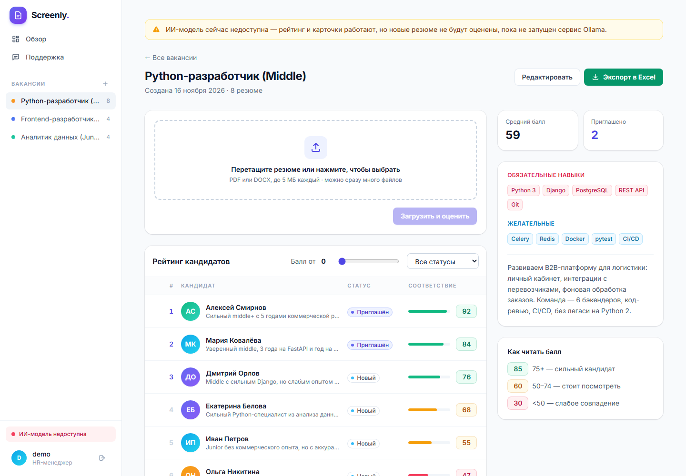
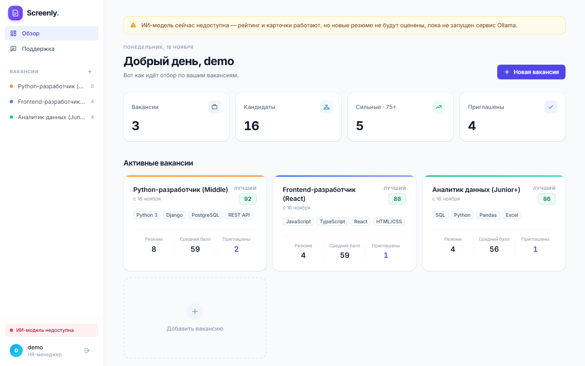
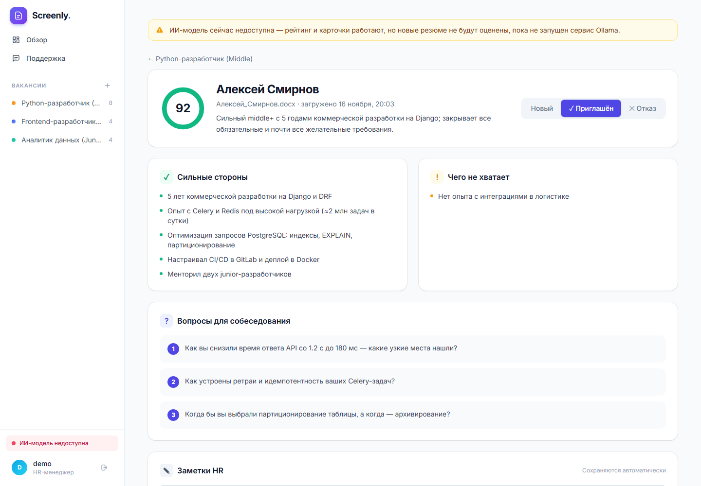
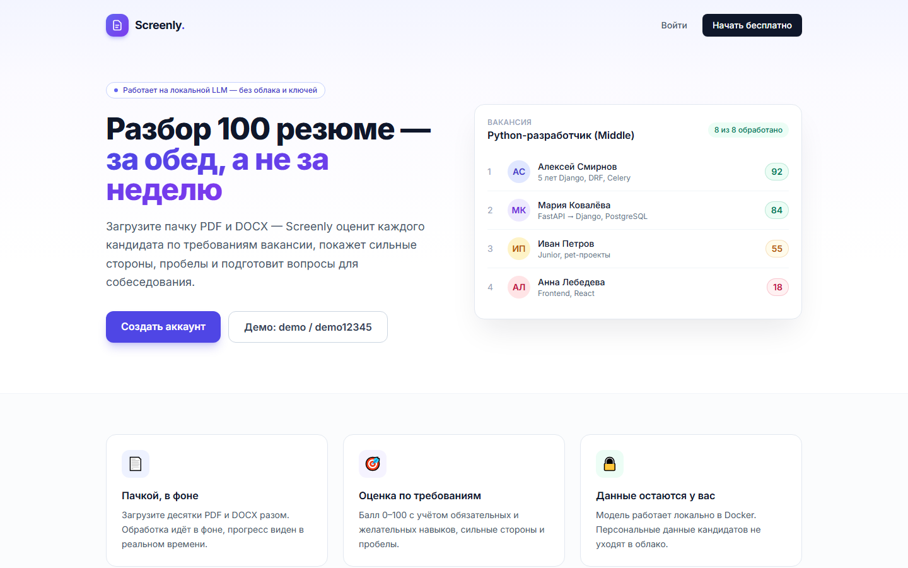
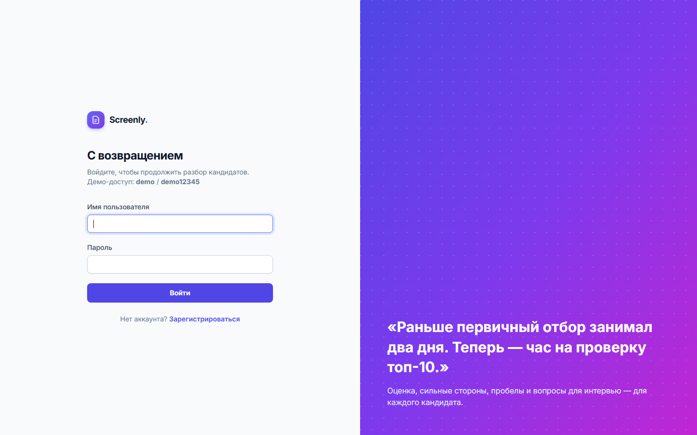

# Screenly — AI-скринер резюме

**Веб-сервис для HR, который за минуты оценивает пачку резюме по требованиям вакансии с помощью локальной LLM — без облака и API-ключей.**



## Какую проблему решает

На одну вакансию приходят десятки и сотни откликов. Рекрутер тратит дни, чтобы прочитать каждое резюме,
сопоставить его с требованиями и подготовиться к интервью. Screenly делает первичный отбор автоматически:

- ставит каждому кандидату **оценку 0–100** с учётом обязательных и желательных навыков;
- объясняет оценку: **сильные стороны** и **чего не хватает**;
- готовит **3 вопроса для собеседования**, бьющих в слабые места;
- строит **рейтинг**, где можно фильтровать, менять статусы и выгружать результат в **Excel**.

Модель работает **локально в Docker** (Ollama + qwen2.5:3b), поэтому персональные данные кандидатов не покидают сервер.

## Скриншоты

| Вакансии | Карточка кандидата |
|---|---|
|  |  |

| Лендинг | Вход |
|---|---|
|  |  |

## Стек

| Слой | Технологии |
|---|---|
| Backend | Python 3.12, Django 5, PostgreSQL 16 |
| Фоновые задачи | Celery + Redis |
| LLM | Ollama, модель `qwen2.5:3b` (структурированный JSON-вывод) |
| Валидация ответа LLM | Pydantic v2 |
| Frontend | Django Templates, Tailwind CSS, HTMX |
| Файлы | pypdf, python-docx, openpyxl |
| Тесты | pytest, pytest-django |
| Инфраструктура | Docker Compose |

## Как запустить

Нужен только [Docker Desktop](https://www.docker.com/products/docker-desktop/) (выделите ему 6+ ГБ RAM).

```bash
git clone <repo-url> && cd resume-screener
cp .env.example .env
docker compose up --build
```

Откройте http://localhost:8000 и войдите как **demo / demo12345** — демо-вакансия и 8 кандидатов уже загружены.

> При первом запуске сервис `ollama-pull` скачивает модель (~2 ГБ). Пока он не завершится,
> новые резюме будут получать статус «модель ещё скачивается» — их можно перезапустить кнопкой «Повторить анализ».

Полезные команды:

```bash
docker compose exec web pytest                         # тесты
docker compose exec web python manage.py load_demo     # пересоздать демо (готовые оценки)
docker compose exec web python manage.py load_demo --llm   # демо, оценённое настоящей LLM
```

Файлы демо-резюме в формате DOCX появляются в папке `demo_data/` — их удобно загрузить вручную, чтобы увидеть прогресс-бар.

**Без Docker** — SQLite, резюме обрабатываются синхронно, LLM берётся из [Ollama](https://ollama.com), установленной на компьютер:

```bash
ollama pull qwen2.5:3b
pip install -r requirements.txt
cp .env.example .env    # и поменяйте OLLAMA_URL на http://localhost:11434
USE_SQLITE=1 python manage.py migrate
USE_SQLITE=1 python manage.py load_demo
USE_SQLITE=1 python manage.py runserver
```

На обычном ноутбуке без видеокарты одно резюме оценивается примерно 1–2 минуты.

## Как это устроено

```
Загрузка PDF/DOCX ──► Candidate(pending) ──► Celery task
                                              ├─ извлечение текста (pypdf / python-docx)
                                              ├─ запрос в Ollama с JSON-схемой ответа
                                              ├─ проверка Pydantic → при ошибке 1 повторный запрос
                                              └─ сохранение оценки / понятной ошибки
Страница вакансии ◄── HTMX опрашивает прогресс раз в 2 с и обновляет рейтинг
```

Ключевые решения:

- **Фоновая обработка.** На CPU модель тратит 20–60 секунд на резюме. Обработка в HTTP-запросе повесила бы
  страницу, поэтому каждое резюме — отдельная задача Celery. Задача ставится через `transaction.on_commit`,
  чтобы worker не взял запись раньше, чем она сохранится в БД.
- **Надёжный JSON от LLM.** Три уровня защиты: Ollama получает JSON-схему (`format`), ответ валидируется
  Pydantic-моделью (оценка 0–100, ровно 3 вопроса и т.д.), при ошибке модели отправляется её же ответ с
  описанием проблемы. Не помогло — кандидат получает статус «Ошибка» с понятным текстом и кнопку повтора.
- **Изоляция данных.** Все запросы фильтруются по владельцу (`owner=request.user`). Чужая вакансия отдаёт
  404, а не 403, — так нельзя даже узнать, что объект существует. Покрыто тестами.
- **HTMX вместо SPA.** Живой прогресс, фильтры без перезагрузки и смена статусов — без отдельного
  фронтенда на React, вся логика остаётся в Django.
- **Бизнес-логика в `services/`.** Парсинг, LLM и экспорт — чистые функции, которые легко тестировать
  отдельно от views.

## Структура

```
config/                  настройки, URL, Celery
accounts/                регистрация и вход
vacancies/               вакансии и дашборд
candidates/
  services/parsing.py    PDF/DOCX → текст
  services/llm.py        промпт, запрос в Ollama, валидация, ретрай
  services/export.py     рейтинг → Excel
  tasks.py               Celery-задача обработки резюме
  demo_data.py           выдуманные демо-резюме
templates/               Tailwind + HTMX шаблоны
tests/                   парсинг, LLM, права доступа
```

## Тесты

27 тестов: парсинг PDF/DOCX и битых файлов, разбор и валидация ответа LLM, логика повторного запроса,
фоновая задача, права доступа ко всем страницам, загрузка и экспорт. LLM в тестах замокана — Ollama не нужна.

```bash
pytest -q
```

## Как я разрабатывал с Claude Code

Проект сделан в паре с [Claude Code](https://claude.com/claude-code) — AI-ассистентом в терминале.

1. **Сначала контекст.** Первым делом сгенерировал `CLAUDE.md` — описание проекта, стек, структуру и правила
   (бизнес-логика в `services/`, проверка владельца в каждом view, LLM в тестах мокается). Этот файл ассистент
   читает в каждой сессии, поэтому код получается единообразным.
2. **План по этапам.** Попросил разбить работу на этапы (каркас → аккаунты → вакансии → парсинг → LLM →
   рейтинг → экспорт → тесты) и утверждал каждый перед реализацией.
3. **Ревью решений.** Ключевые решения (Celery вместо синхронной обработки, JSON-схема + Pydantic + ретрай,
   404 вместо 403) я разбирал и проверял сам — и могу объяснить, почему они такие.
4. **Проверка.** После каждого этапа — ручная проверка в браузере и прогон `pytest`.

Что я вынес: AI-ассистент сильно ускоряет рутину (шаблоны, конфиги, тесты), но архитектурные решения,
постановка задачи и проверка результата остаются на разработчике.
